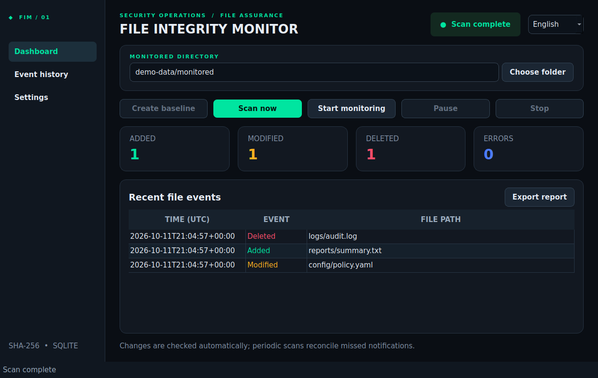
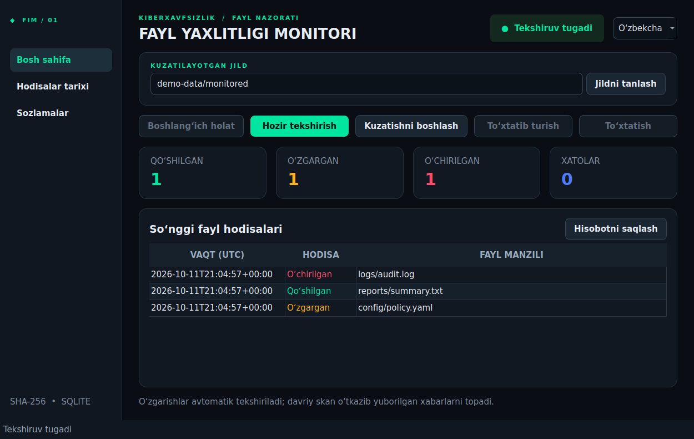
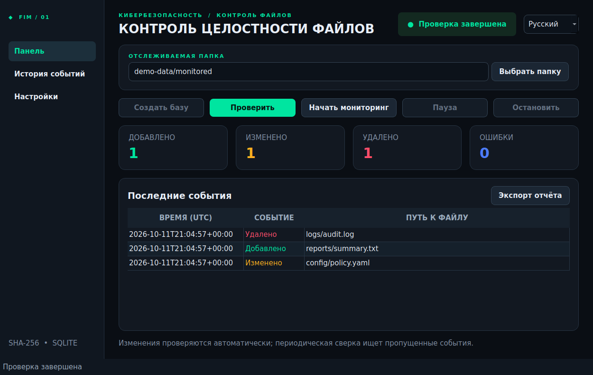

# FIM Guard

[](https://github.com/shomatoff/fim-guard/actions/workflows/ci.yml)

**EN:** A desktop tool that records SHA-256 baselines for selected folders and shows added, changed, and deleted files. It uses SQLite for event history and watchdog for live monitoring.

**UZ:** Tanlangan jildlar uchun SHA-256 boshlang‘ich holatini yozib, qo‘shilgan, o‘zgargan va o‘chirilgan fayllarni ko‘rsatadigan desktop dastur. Hodisalar SQLite’da saqlanadi, jonli kuzatuv watchdog bilan ishlaydi.

**RU:** Настольное приложение создаёт базу SHA-256 для выбранных папок и показывает добавленные, изменённые и удалённые файлы. История хранится в SQLite, мониторинг работает через watchdog.



## Screenshots / Skrinshotlar / Снимки

| English | O‘zbekcha | Русский |
| --- | --- | --- |
|  |  |  |

[Monitoring events](docs/screenshots/monitoring-events.png) · [Settings](docs/screenshots/settings.png)

## Features

- Manual scans and continuous watchdog monitoring with pause, resume and periodic reconciliation.
- SHA-256 baseline and SQLite event history across selected folders; duplicate alerts are suppressed after a complete scan.
- Added, modified and deleted events with UTC timestamps; JSON and CSV report exports.
- Incomplete scans do not advance the baseline or produce misleading change alerts.
- Symlink targets are skipped. Monitored files are never modified.
- English, Uzbek (Latin) and Russian UI with persistent language choice.

## Technologies

| Component | Technology |
| --- | --- |
| Desktop interface | Python 3.12, PySide6 |
| Integrity checks | SHA-256, Python standard library |
| Continuous monitoring | watchdog |
| Local history | SQLite |
| Testing and quality | pytest, Ruff |
| Packages and CI | PyInstaller, GitHub Actions |

## Download packages / Paketlar / Пакеты

After a successful tagged release, download the Windows ZIP or Linux TAR.GZ from [Releases](https://github.com/shomatoff/fim-guard/releases). Development packages appear under [Actions artifacts](https://github.com/shomatoff/fim-guard/actions). The two platforms are built on their own GitHub runners. See [platform instructions](docs/PLATFORMS.md). Packages are unsigned; no release exists until its CI job succeeds.

## Install and run / O‘rnatish / Установка

Python **3.12** on Linux or Windows:

```sh
python -m venv .venv
# Linux: source .venv/bin/activate
# Windows PowerShell: .venv\Scripts\Activate.ps1
python -m pip install -r requirements.txt
python main.py
```

On Linux, install your distribution's Qt XCB runtime libraries if the application cannot start. See [English guide](docs/README_EN.md) for examples. No monitored directory is scanned until you select one.

## Usage / Foydalanish / Использование

1. Choose a directory, then create its baseline.
2. Use **Scan now** for a manual check, or **Start monitoring** for automatic checks.
3. Pause or resume monitoring as needed; review the event table and history.
4. Export the latest scan as JSON or CSV. Reports include scan status, counts, event paths and hashes, never file contents.

## Architecture

`fim/engine.py` hashes files and compares snapshots; `fim/database.py` persists baselines and events; `fim/monitor.py` handles watchdog; `fim/ui.py` displays results; `fim/translations.py` supplies all interface strings; `fim/reporting.py` exports reports. See [architecture](docs/ARCHITECTURE.md).

## Tests and builds

```sh
python -m pytest -q
python -m ruff check .
python scripts/build.py
```

[GitHub Actions](.github/workflows/ci.yml) runs tests and quality checks, builds separate Windows and Linux packages, uploads artifacts, and creates releases for `v*` tags. The status of the latest run is visible in the repository's **Actions** tab. Windows has not been tested on physical hardware. See [testing](docs/TESTING.md), [security](docs/SECURITY.md), [changelog](docs/CHANGELOG.md), and [license](LICENSE).

## Known limitations

- A partial or interrupted scan reports an error and retains the previous baseline; no events are emitted until a complete scan succeeds.
- Symlinks are skipped, including symlinked directories. File metadata alone does not constitute a change; SHA-256 content does. The history view shows the latest 1,000 records while SQLite retains older events.
- Large trees may take time because every regular file is hashed on each scan. Network filesystems may have unreliable watchdog notifications, so periodic reconciliation is used.
- Packages are unsigned. Windows packaging is automated in CI but real Windows hardware has not been tested.

Detailed guides: [English](docs/README_EN.md) · [O‘zbekcha](docs/README_UZ.md) · [Русский](docs/README_RU.md).
